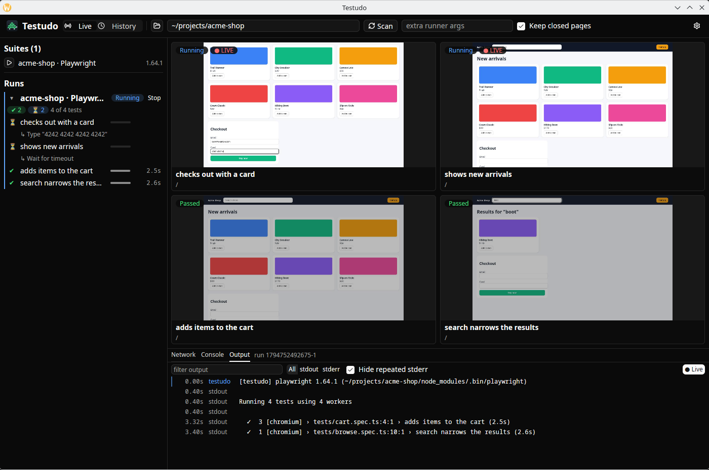
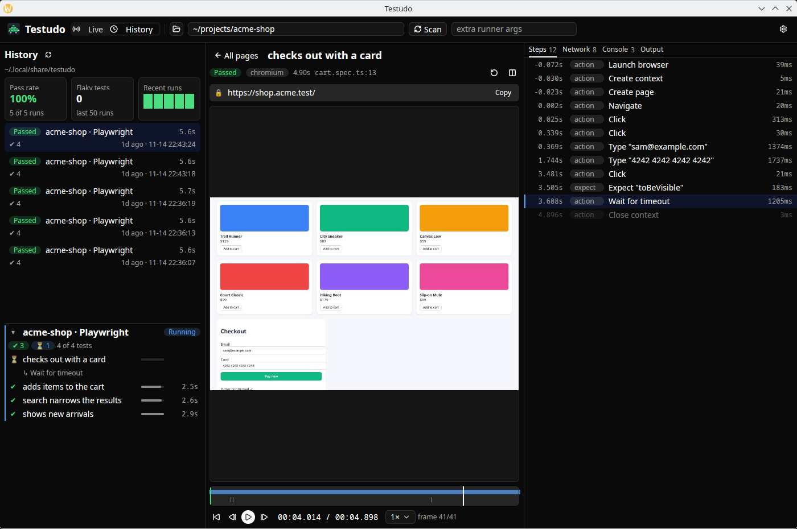
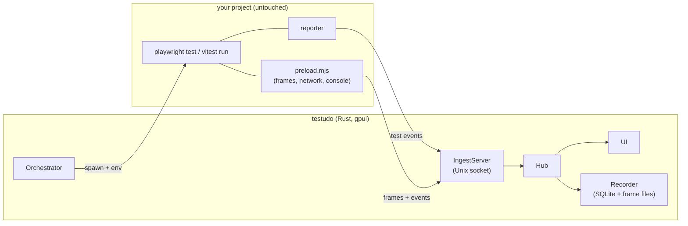

<p align="center"></p>

<h1 align="center">Testudo</h1>

<p align="center"><em>Watch your tests, not your terminal.</em></p>

Native GUI test runner that controls, monitors and reports on multiple concurrent test suites, with live views of the headless browsers they drive. Every run is recorded so you can scrub through it, compare it with earlier runs and spot flaky tests. Nothing is installed into or written to your project.



## Compatibility

| Test system | Status | Live browser view | Re-run one test | Tested with |
|---|---|:---:|:---:|---|
| [Playwright Test](https://playwright.dev) | ✅ Supported | ✅ | ✅ | 1.60, 1.64 |
| [Vitest](https://vitest.dev) 3+ | ✅ Supported | ✅ ¹ | ✅ | 4.1 |
| [Storybook](https://storybook.js.org) | ✅ Supported ² | ✅ | ✅ | addon-vitest |
| [Jest](https://jestjs.io) | 🗓️ Planned | — | | |
| [Bun](https://bun.sh/docs/cli/test) | 🗓️ Planned | — | | |
| [Rstest](https://rstest.rs) | 🗓️ Planned | | | |
| Go | 🗓️ Planned ³ | — | | |
| Rust | 🗓️ Planned | — | | |

<sub>¹ In browser mode (Playwright provider).</sub><br><sub>² Through its Vitest addon or a Playwright story suite.</sub><br><sub>³ Already found by Scan, not runnable yet.</sub><br><sub>— The runner drives no browser.</sub>

Point Testudo at any directory, including a monorepo root, and it finds `playwright*.config.*`, Vitest configs and workspaces, and `vite.config.*` files with a `test` block. Each suite runs with the runner installed in its own project and the Node version from its `.nvmrc` / `.node-version` (nvm and fnm), so a monorepo can mix versions. Chromium is captured on every supported Playwright version; Firefox and WebKit where Playwright has `page.screencast`.

In a git repository with linked worktrees, the directory box shows the main worktree and a selector beside it picks which worktree to scan and run; opening Testudo inside a linked worktree preselects it. Scans skip any folder below the root that has its own `.git` (linked worktrees such as `.claude/worktrees/*`, nested clones, submodules), so one worktree never lists another's suites.

Runs on Linux and macOS.

## Screenshots

**Watch or scrub one page** with its steps, network and console in step with the recording:



**Compare with up to 5 earlier runs** of the same test, played side by side and aligned by step:


**History** of every run, with pass rate, flaky tests and a timeline you can replay:


## Install

Tagged releases publish prebuilt Linux and macOS archives on the [Releases](https://github.com/ScarecrowAU/testudo/releases) page. To build from source (needs a Rust toolchain):

```sh
make install                     # into ~/.local, with a desktop entry
make install PREFIX=/usr/local   # system-wide (run with sudo)
make uninstall                   # run history is kept
```

On Linux this adds a desktop entry and icons. On macOS it adds `Testudo.app` to `~/Applications` (`MACAPPDIR=/Applications` for all users), so Spotlight, Launchpad and the Dock show Testudo with its icon; the app runs the installed `bin/testudo`, so updates apply to it. Started from a terminal, Testudo shows its icon in the Dock too.

ffmpeg is optional, for MP4 export.

### Updates

Testudo checks GitHub for a newer version at startup and once a day, and offers to install it in place; restart to use it. Pick the channel in Settings or with `testudo-cli update --channel`:

| Channel | Follows | Installs |
|---|---|---|
| `stable` (default) | GitHub releases | The release archive for your platform, after checking its signature against the key built into Testudo. |
| `bleeding-edge` | Every commit on `main` | A build of that commit, made on your machine in `~/.cache/testudo/src`. Needs git and a Rust toolchain. |

```sh
testudo-cli update --check   # report whether there's a newer version
testudo-cli update           # install it
```

Installs Testudo can't write to (such as `/usr/local` without sudo) and development builds only report updates.

## Usage

```sh
testudo ~/dev/my-repo                      # list the suites found in the repo
testudo ~/dev/my-repo --run playwright     # ...and start the matching ones
testudo --replay <run-id> --at 1.5         # open a recorded run at 1.5 s

testudo-cli suites ~/dev/my-repo           # list discovered suites
testudo-cli run ~/dev/my-repo              # run every suite headlessly, recorded
testudo-cli history
testudo-cli export <run-id> <page-id> out.mp4
```

Filters match `all`, a runner name, or part of a suite name or config path. Arguments after `--` go to every started runner.

In the focus view: wheel scrubs, Shift+wheel or ←/→ steps one frame, Space plays or pauses, Esc returns to the grid. Stopping a run (button, closing the window, Ctrl+C) lets the runner tear down cleanly before anything is killed.

## Configuration

Recording resolution and frame rate, where recordings are kept, deleting old recordings and updates are in Settings (⚙, top right), saved to `~/.config/testudo/settings.json` and shared with `testudo-cli`.

| Environment variable | Default | Effect |
|---|---|---|
| `TESTUDO_DATA_DIR` | `~/.local/share/testudo` | Where history and recordings live. |
| `TESTUDO_CONFIG_DIR` | `~/.config/testudo` | Where settings live. |
| `TESTUDO_KEEP_RUNS` | 200 | Delete whole runs beyond the newest N. |
| `TESTUDO_MAX_FRAMES_MB` | 5120 | Oldest runs lose their frames first; results stay. |
| `TESTUDO_KEEP_FRAMES` | `all` | `failed` keeps frames only for failing tests. |

### Project config

A project can give its runs extra environment variables and arguments in `.testudo/config.json` (JSON5: comments, unquoted keys, single quotes and trailing commas are fine). Testudo uses the nearest one at or above the scanned directory, up to the repository root, and paths in it are relative to the folder holding `.testudo`.

```json5
{
  $schema: "https://raw.githubusercontent.com/ScarecrowAU/testudo/main/schemas/testudo-config.schema.json",
  rules: [
    // Global: no `path`, applies to every suite (of the listed runners).
    { runner: "playwright", env: { CI: "1" }, args: ["--retries=1"] },
    // Local: applies to suites whose directory matches the glob.
    {
      path: "apps/web/**",
      runner: ["playwright", "vitest"],     // optional, default: all runners
      env: { API_URL: "http://localhost:4000" },
      env_file: "apps/web/.env.test",       // KEY=value lines
      args: ["--workers=2"],
      replaceGlobalArgs: true,              // drop the global rules' args
    },
  ],
}
```

`path` matches the suite's directory: `*` stays within one folder, `**` crosses folders. Matching rules merge, globals first and then locals, each in file order, so local rules win conflicts. `env` merges by name (in a rule, `env` beats `env_file`). `args` are appended: global, then local, then the runner args typed in the GUI or given after `--`. Testudo's own variables take precedence, and `NODE_OPTIONS` and `PATH` are combined with Testudo's. The run output lists the variable names it set (not their values). Each run reads the config (and its `env_file`s) when it starts, so edits apply to the next run without a rescan. A config that doesn't parse, or a missing `env_file`, shows as a warning on the affected suites when scanned, and a run won't start until it's fixed.

The `$schema` line gives editors completion, hover docs and validation from [`schemas/testudo-config.schema.json`](schemas/testudo-config.schema.json). Editors read `.json` files as JSON (with comments), so quote keys and use double quotes to keep the editor happy; Testudo itself accepts full JSON5 either way.

## How it works



The adapters in `adapters/js` are injected through the runner's command line and environment only (`PW_TEST_REPORTER`, `--reporter`, `NODE_OPTIONS=--import`). Frames are stored as the browser's own JPEGs, with repeated frames deduplicated.

| Path | What |
|---|---|
| `crates/protocol` | Wire format shared with `adapters/js/transport.mjs`. |
| `crates/core` | Orchestrator, suite discovery, ingest socket, hub. |
| `crates/store` | Run history (SQLite), frame recordings, retention, MP4 export. |
| `crates/ui` | The `testudo` GUI (gpui via gpui-kit). |
| `crates/cli` | `testudo-cli`. |
| `crates/update` | Update checks and in-place installs from releases or `main`. |
| `adapters/js` | Zero-dependency Node adapters. |
| `examples/` | Playwright and Vitest-browser demo projects. |

## Developing

```sh
make dev                                         # rebuild on change, restart the GUI
make dev ARGS="~/dev/some-app --run playwright"  # args are passed to testudo
make test
make lint
```

`make dev` restarts only after a successful build and logs to `target/dev/testudo.log`. Set `TESTUDO_OTLP_ENDPOINT=http://<collector>:4318` (in `dev/.env` for `make dev`) to export Testudo's own traces over OTLP/HTTP.

See [CONTRIBUTING.md](CONTRIBUTING.md) for setup, conventions and how pull requests are reviewed.

## License

Licensed under either of [Apache License, Version 2.0](LICENSE-APACHE) or [MIT license](LICENSE-MIT), at your option.

Unless you explicitly state otherwise, any contribution intentionally submitted for inclusion in Testudo by you, as defined in the Apache-2.0 license, shall be dual licensed as above, without any additional terms or conditions.
