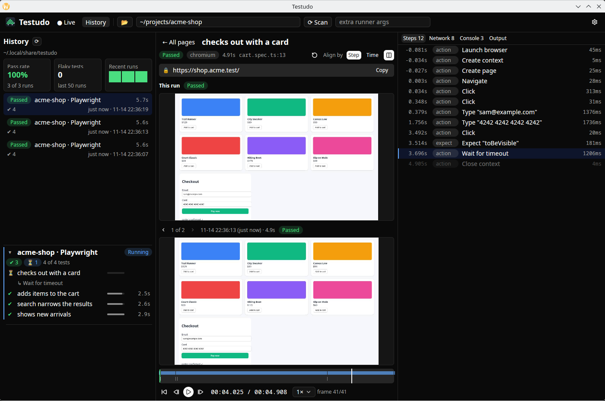
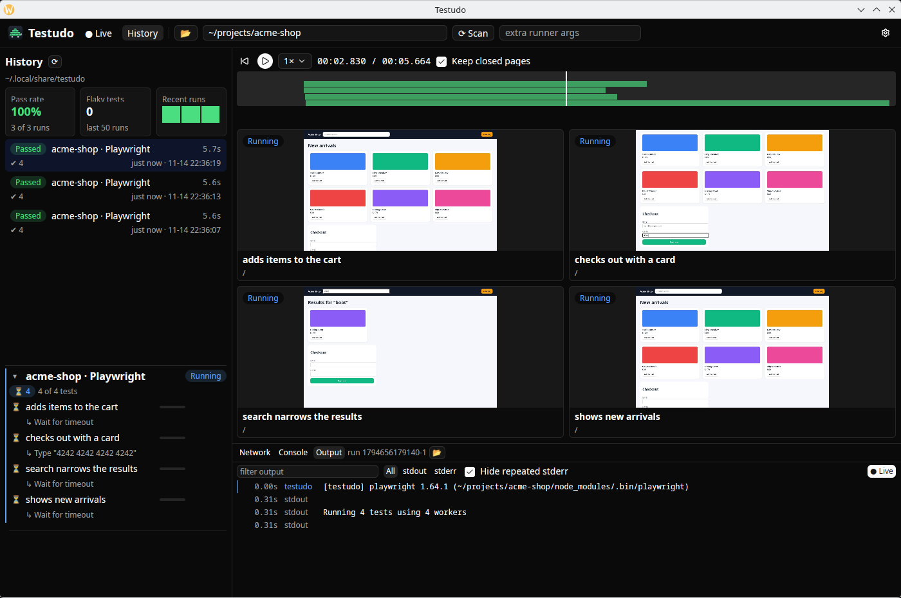
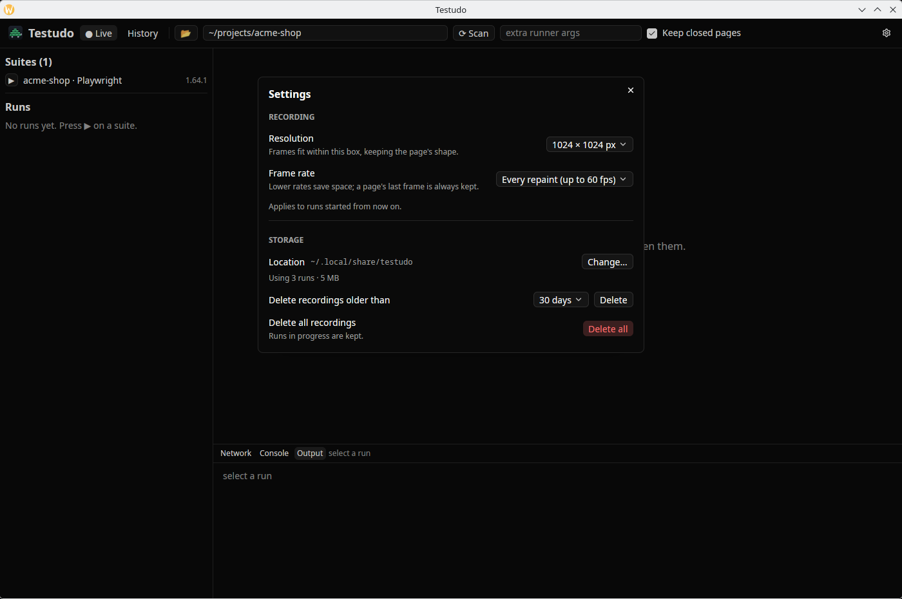
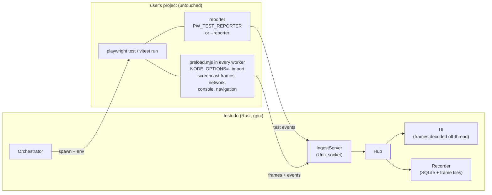

# Testudo

Native GUI test runner that controls, monitors and reports on multiple concurrent test suites, with live views of the headless browsers they drive.


## Compatibility

| Test system | Status | Live browser view | Re-run one test | Tested with |
|---|---|:---:|:---:|---|
| [Playwright Test](https://playwright.dev) | ✅ Supported | ✅ | ✅ | 1.60, 1.64 |
| [Vitest](https://vitest.dev) 3+ | ✅ Supported | ✅ ¹ | ✅ | 4.1 |
| [Storybook](https://storybook.js.org) | ✅ Supported ² | ✅ | ✅ | addon-vitest |
| [Jest](https://jestjs.io) | 🗓️ Planned | — | | |
| [Bun](https://bun.sh/docs/cli/test) | 🗓️ Planned | — | | |
| [Rstest](https://rstest.rs) | 🗓️ Planned | | | |
| Go | 🗓️ Planned ³ | — | | |
| Rust | 🗓️ Planned | — | | |

<sub>¹ In browser mode (Playwright provider).</sub><br><sub>² Through its Vitest addon or a Playwright story suite.</sub><br><sub>³ Already found by Scan, not runnable yet.</sub><br><sub>— The runner drives no browser.</sub>

- **Found by**: `playwright.config.*`; `vitest.config.*`, Vitest workspaces and `vite.config.*` with a `test` block; `go.mod`. Each suite uses the runner version installed in its own project, so a monorepo can mix versions.
- **Results**: tests, steps (Playwright), skip reasons and tests not started yet, live and in History.
- **Re-run one test**: `file:line`, plus `--project` for Playwright.
- **Browsers**: Chromium is captured on every supported Playwright version; Firefox and WebKit only where Playwright has its cross-browser `page.screencast` API (recent versions, not yet tested).

## Screenshots

**Watch or scrub one page** with its steps, network and console in step with the recording:


**Compare with earlier runs** of the same test, played side by side in step; arrows move through the test's history:



**History** of every run, with pass rate, flaky tests and a timeline you can replay:



**Settings** for recording resolution and frame rate, where recordings are kept, and cleanup:



## How it works



Nothing is installed into or written to the user's project. Runs use the project's Node version: the nearest `.nvmrc` / `.node-version` is matched against nvm and fnm installs (exact, else newest same-major), and the choice is printed at the top of the run output. Instrumentation is injected entirely through the runner's command line and environment:

| Piece | Injection | Provides |
|---|---|---|
| `adapters/js/playwright-reporter.mjs` | `PW_TEST_REPORTER` env (appended after configured reporters) | test/step lifecycle |
| `adapters/js/vitest-reporter.mjs` | `--reporter` CLI flags | test lifecycle |
| `adapters/js/preload.mjs` | `NODE_OPTIONS=--import` | live JPEG frames, network, console, per page, tagged with the Playwright test id |

The preload hooks `playwright-core` through its client instrumentation (`runAfterCreateBrowserContext`), the same hook Playwright Test's tracing uses, and falls back to method wrapping on older versions. It resolves every copy of playwright-core reachable from the project root (pnpm/monorepo safe). Both mechanisms are internal Playwright APIs: pin and test against supported versions.

## Layout

| Path | What |
|---|---|
| `crates/protocol` | Wire format: length-prefixed JSON events and binary JPEG frames. Mirrored in `adapters/js/transport.mjs`. |
| `crates/core` | Orchestrator (spawn, process-group cancel), ingest socket, hub. |
| `crates/store` | Run history (SQLite) and frame recordings; `Recorder` hub subscriber; retention; MP4 export. |
| `crates/ui` | `testudo` GUI on gpui (via gpui-kit). Live view, focus view, History with timeline replay. |
| `crates/cli` | `testudo-cli`: headless runs (recorded), history, show, export, prune. |
| `adapters/js` | Zero-dependency Node adapters shipped with Testudo. |
| `examples/` | Playwright and Vitest-browser demo projects for smoke testing. |

## Install

```sh
make install                     # release build into ~/.local (bin/, lib/testudo/adapters/, desktop entry)
make install PREFIX=/usr/local   # system-wide (run with sudo)
make uninstall                   # removes the install; run history is kept
```

Needs a Rust toolchain; ffmpeg is optional (MP4 export). `make help` lists the other targets (`test`, `lint`, `clean`).

## Developing

```sh
make dev                                         # rebuild on change, restart the GUI
make dev ARGS="~/dev/some-app --run playwright"  # args are passed to testudo
```

The app restarts only when the build succeeds; a compile error keeps the current window. Edits made while a build is running cancel it and rebuild from the latest state, so there is one restart per settled change. Restarts close the app gracefully (active runs are stopped cleanly). Adapter edits (`adapters/js`) need no restart; each run loads them fresh. Closing the window ends the loop.

### Logs and traces

- `make dev` writes the app's log to `target/dev/testudo.log` (new file per restart, previous one kept as `testudo.prev.log`). Any build: `TESTUDO_LOG_FILE=<path>`; level via `RUST_LOG`.
- Traces: put `TESTUDO_OTLP_ENDPOINT=http://<collector>:4318` in `dev/.env` (gitignored) and `make dev` exports Testudo's spans there whenever the collector answers: `run` (spawn to exit, with exit code), `adapter_connection` (events/frames/bytes per adapter), `drain_adapter_connections`, `stop_process_group`, `recorder_finish_run`, `discover`, `replay_load`, `compare_open`, `export_mp4`, user actions (`switch_mode`, `open_focus`, `close_focus`, `open_replay`, `start_suite`), and UI performance: `slow_frame` (a frame that took over 16 ms to build, or over 33 ms between frames while scrolling or dragging) and `ui_scroll` (one per scroll or drag burst: fps, average and slowest frame, rows on screen). Scroll bursts are also logged to `target/dev/testudo.log` (service name `testudo`).
- Any OTLP/HTTP collector works: `TESTUDO_OTLP_ENDPOINT=http://host:port` (plus `TESTUDO_OTLP_TOKEN` for a bearer token, `TESTUDO_OTLP_FILTER` to change what is exported, `TESTUDO_OTLP_LOGS=1` to export log events if the collector has a logs pipeline). These are Testudo-specific so the `OTEL_*` variables meant for your apps don't capture Testudo, and they are removed from test runs' environment.

## Running from source

```sh
# demos need deps + browsers once
(cd examples/playwright-demo && npm install && npx playwright install chromium-headless-shell)
(cd examples/vitest-browser-demo && npm install)

cargo run -p testudo-ui -- ~/dev/my-repo                  # GUI: lists the suites found in the repo
cargo run -p testudo-ui -- ~/dev/my-repo --run all        # ...and starts them all
cargo run -p testudo-ui -- --replay <run-id> --at 1.5     # open a recorded run at 1.5s
cargo run -p testudo-cli -- suites ~/dev/my-repo          # list discovered suites
cargo run -p testudo-cli -- run ~/dev/my-repo             # run every runnable suite, recorded
cargo run -p testudo-cli -- run storybook ~/dev/my-repo   # only suites matching a filter
cargo run -p testudo-cli -- history
cargo run -p testudo-cli -- export <run-id> <page-id> out.mp4
```

Filters (`--run` in the GUI, positional in the CLI) match `all`, a runner (`playwright`, `vitest`) or part of a suite name or config path. Arguments after `--` go to every started runner.

## Suite discovery

Point Testudo at any directory, including a monorepo root. It walks the tree (skipping `node_modules`, build output and hidden dirs) and lists:

- each `playwright*.config.*` as a Playwright suite (`playwright.storybook.config.ts` is its own suite);
- Vitest configs and workspaces, and `vite.config.*` files with a `test` block (configs inside a Vitest workspace belong to the workspace);
- Go modules, shown as not yet supported.

Every suite runs from its own directory with its own runner: the nearest `node_modules/.bin/<runner>` walking upward, so apps pinned to different Playwright versions each use theirs. The version is shown per suite, and a Playwright suite whose Chromium build is missing from the browser cache gets a warning. Testudo never falls back to `npx`, which would silently fetch whatever version is latest; a suite without an install is listed as not runnable, with the reason.

Running several suites at once on one machine can make timing-sensitive tests flaky (CPU contention); per-test history flags tests that both pass and fail.

## Stopping runs

Stop (button), closing the window, Ctrl+C, SIGTERM and SIGHUP all stop runs the way a terminal would: SIGINT to the runner's process group so it runs its own teardown (Playwright stops its `webServer`, reporters flush), escalating to SIGTERM after 5s and SIGKILL 2s later. Helpers that left the process group (Playwright starts `webServer` detached) are found from a `/proc` snapshot taken when the stop began and are cleaned up too, matched by pid and start time. The recorder then writes each run's final status before Testudo exits. A second signal to the GUI exits immediately. Sockets left by a crashed Testudo are removed on next start.

## Watching and scrubbing a page

Click any page pane to open it in a replay-player layout:

- **Player**: test title with status and browser pills and `file:line`; a browser-style URL bar showing the URL at the scrub time (with copy); the frame; a timeline with step bars, request ticks, navigations (green) and console errors (red), hover to name what is under the pointer; controls beneath.
- **Running page**: follows the browser live (● LIVE). Scroll back to drop into what has been recorded so far; ● LIVE returns. If the page closes while you watch, it becomes a recording.
- **Finished page, or any page in History**: wheel = scrub, Shift+wheel or ←/→ = one frame, Space = play/pause, Esc = back to the grid.
- **Details panel, synced to the scrub time**: *Steps* (every Playwright action, expect and `test.step` with timing; the current one highlighted), *Network* (table with type/error filter chips, URL search), *Console* (level filter) and *Output*. Rows not reached yet are faded, in-flight requests are blue, and clicking any row jumps there.

`testudo --replay <run-id> --at <secs> --focus <page-id>` opens straight into a page (page ids are listed by `testudo-cli show <run-id>`).

## Recording and history

Every run is recorded by default, from the GUI and the CLI alike.

- **Events** (test lifecycle, steps, network, console, runner output) go to SQLite with their receive time. Replay re-applies them up to the scrub time, so the History view is the live view rewound: tests mid-step, network and console as of that moment, panes opening and closing.
- **Frames** are the raw screencast JPEGs, appended per page with no re-encoding. Browsers only emit frames on repaint, and each distinct image is stored once; repeats (spinners, cursor blink, looping animation) become 20-byte references. MP4 export resamples to constant fps via ffmpeg on demand.
- **Settings** (⚙, top right; saved in `~/.config/testudo/settings.json`, `TESTUDO_CONFIG_DIR` overrides the directory; shared with `testudo-cli`):
  - *Resolution*: frames fit within an N×N box, keeping the page's shape (640 to 1920 px, default 1024). Pages smaller than the box are kept at their own size: no padding, cropping or upscaling.
  - *Frame rate*: every repaint (up to 60 fps, default) or a cap of 30, 15, 10 or 5 fps. A frame that arrives too soon is held and sent when its slot comes up, so a page's last state is always recorded.
  - Both apply to runs started afterwards.
  - *Location* of recordings and history (folder picker); takes effect the next time Testudo starts, existing recordings stay where they are. `TESTUDO_DATA_DIR` overrides it.
  - *Delete recordings older than* 1, 3, 7, 14, 30 or 60 days, or *delete all*, after a confirmation. Runs in progress are kept; it reports what was freed.
- **Per-test history**: hover a test to see its recent results across runs; mixed passes and failures are flagged as flaky. The History view opens with a summary of the last 50 runs: pass rate, flaky tests (hover for the list) and a sparkline of recent run durations coloured by result.
- **Output** is a timestamped log table (source column, severity bars, stream filter); ● Live follows new lines and turns off when you scroll up.
- Runs left `running` by a crashed Testudo are marked `interrupted` on next start.

Data lives in `$TESTUDO_DATA_DIR`, else `$XDG_DATA_HOME/testudo`, else `~/.local/share/testudo`.

| Retention env | Default | Effect |
|---|---|---|
| `TESTUDO_KEEP_RUNS` | 200 | Delete whole runs beyond the newest N. |
| `TESTUDO_MAX_FRAMES_MB` | 5120 | Oldest runs lose their frames first; their results and events stay. |
| `TESTUDO_KEEP_FRAMES` | `all` | `failed` keeps frames only for failing tests' pages (like Playwright's `retain-on-failure`). |

Retention is applied at startup and after each run. `testudo-cli prune` applies it on demand.

## Verified against

A real pnpm monorepo app (React, Vite, Playwright 1.60, Vitest 4 in jsdom, Storybook 10 tested through a separate Playwright config, Node 26 via `.nvmrc`):

- Vitest: 84 files / 632 tests recorded (jsdom, so lifecycle only, no browser frames).
- Storybook suite (`-c playwright.storybook.config.ts`, 16 workers): 36 tests, a live pane per story, with contexts created manually through `browser.newContext()` still instrumented and the project's own Argos reporter unaffected.
- Backend e2e suite with the backend offline: the suite's own skips recorded correctly.
- Project working tree unchanged after every run.

## GUI notes (gpui)

The GUI uses gpui through gpui-kit, which pins a weekly snapshot of Zed's in-tree gpui (`gpui-pre`). Expect API changes when upgrading it; pin and upgrade deliberately.

gpui keeps every image it has drawn in a GPU texture atlas until `window.drop_image` is called. Streaming screencast frames without freeing replaced ones leaks GPU memory fast (measured about 128 MB/s at 30 fps). All frame replacement in `crates/ui` hands the old frame to a retire queue that the root view frees at the start of each render; keep new code on that path.

Fonts are resolved per platform (fontconfig on Linux), since gpui needs concrete family names.

## Known gaps / next steps

- Unix only (UDS + process groups). Windows needs a named-pipe listener and Job objects.
- Replay decodes frames on the UI thread; fine for a handful of pages, should move off-thread for large grids.
- Retention settings are env-only; no settings UI yet.
- Descendant cleanup uses `/proc` (Linux); elsewhere only the process group is stopped.
- Node selection covers nvm and fnm only (not mise, volta, asdf, or `lts/*` aliases).
- Playwright 1.60 on Node 26 prints its own `DEP0205 module.register()` warnings; they are not from Testudo.
- Vitest frames are per run, not per test (all tests share one page); correlate by reporter timestamps.
- Direct CDP attach from Rust for Chromium under non-JS runners (Go/chromedp etc).
- Jest, Rstest, `go test -json`, `cargo nextest` adapters.
- Open Playwright traces / HTML reports in the system browser.
